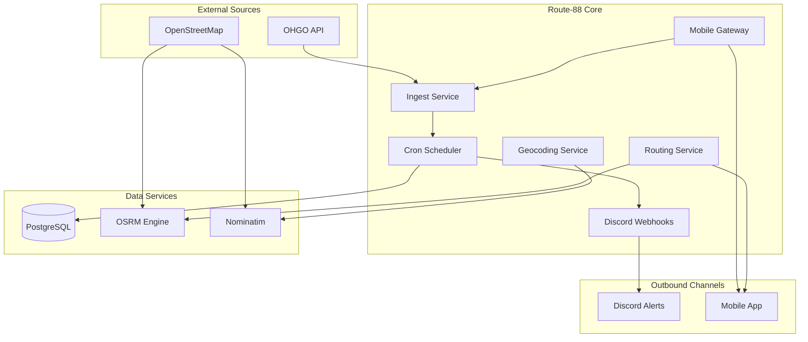

## System Architecture

Route-88 serves as the central data bridge between state-level traffic feeds, local geospatial microservices, and external client channels:



---

## Application Feature Map

The features inside Route-88 are divided into four primary functional domains:

### 1. Traffic Data Ingestion Engine (OHGO)
The ingestion subsystem continuously interfaces with Ohio Department of Transportation endpoints:
* **[Real-Time Incidents](/features/ohgo/incidents)**: Ingests traffic collisions, disabled vehicles, and emergency closures with categorization and severity levels.
* **[Dangerous Slowdowns](/features/ohgo/slowdowns)**: Detects severe speed drops and abnormal bottleneck alerts along high-speed corridors.
* **[Construction & Roadworks](/features/ohgo/construction)**: Tracks scheduled lane closures, maintenance operations, and active contractor work zones.
* **[WZDx v4.2 Standard Feed](/features/ohgo/wzdx)**: Implements the federal Work Zone Data Exchange specification for standardized interoperability.
* **[Cache & ETag Coordination](/infra/database-schema)**: Tracks endpoint state via the `api_cache_state` table to prevent redundant network payload processing.

### 2. Local Routing & Spatial Intelligence
Route-88 embeds localized routing and geocoding capabilities without depending on costly third-party commercial APIs:
* **[Turn-by-Turn Route Calculation](/features/routing/route-calculation)**: Queries the local OSRM instance to compute fastest driving paths, total mileage, duration, and individual turn instructions.
* **[Address Autocomplete](/features/routing/autocomplete)**: Performs fast, debounced address suggestions for Ohio destinations.
* **[Geocoding & Resolution](/features/routing/geocoding)**: Resolves street names and landmarks to precise latitude and longitude coordinates.

### 3. Automated Discord Alerting & Notifications
Keeps communities and response personnel informed in real-time through Discord integrations:
* **[Webhook Dispatcher & Embeds](/features/discord/webhooks)**: Converts raw JSON events into rich Discord embeds with severity color-coding (Red for Incidents, Orange for Slowdowns, Yellow for Construction).
* **[Deduplication & Polling Loop](/features/discord/scheduler)**: Runs every 10 minutes to ingest new events, cross-referencing against PostgreSQL so users never receive duplicate alerts.
* **[Daily 8:00 AM Digest](/features/discord/daily-digest)**: Automatically compiles active regional roadworks and critical slowdowns into a morning briefing.
* **[Slash Command Support](/features/discord/slash-commands)**: Scripting scaffold to register and power interactive Discord UI slash commands.

### 4. Mobile Client Telemetry Gateway
Provides high-performance, low-bandwidth APIs designed specifically for in-vehicle and mobile device clients:
* **[Device Registration & Status](/features/mobile/overview)**: Tracks active mobile client instances and reports backend system health.
* **[Unified Telemetry Feed](/features/mobile/telemetry)**: Allows a mobile client to transmit its coordinate position and receive a unified payload of incidents, slowdowns, and construction zones.
* **[Radial & Bounding Box Filtering](/features/mobile/geospatial-filtering)**: Automatically computes degree-offset bounding boxes based on user-defined search radii.

---

## API Endpoints At A Glance

All application routes are protected by Bearer authentication and validated using Zod schemas:

| Method | Endpoint | Description | Security |
| :--- | :--- | :--- | :--- |
| `GET` | `/` | Service health check | Public |
| `GET` | `/api/discord/incidents` | Fetch filtered OHGO incident feed | Bearer Auth |
| `GET` | `/api/discord/slowdowns` | Fetch hazardous slowdown feed | Bearer Auth |
| `GET` | `/api/discord/construction` | Fetch active construction projects | Bearer Auth |
| `GET` | `/api/discord/daily-feed` | Trigger background daily digest dispatch | Bearer Auth |
| `GET` | `/api/mobile/status` | Mobile gateway status probe | Bearer Auth |
| `POST`| `/api/mobile/register` | Register mobile client device ID | Bearer Auth |
| `GET` | `/api/mobile/telemetry` | Multi-event localized telemetry feed | Bearer Auth |
| `GET` | `/api/mobile/incidents` | Scoped mobile incident query | Bearer Auth |
| `GET` | `/api/mobile/slowdowns` | Scoped mobile slowdown query | Bearer Auth |
| `GET` | `/api/mobile/construction`| Scoped mobile construction query | Bearer Auth |
| `GET` | `/api/route/calculate` | Calculate OSRM turn-by-turn route | Bearer Auth |
| `GET` | `/api/route/autocomplete` | Address autocomplete and suggestions | Bearer Auth |

---

## Technology Stack

```
Runtime:      Bun 1.3+
Framework:    Hono v4
Database:     PostgreSQL 17 Alpine + Drizzle ORM
Validation:   Zod
Routing:      OSRM (Open Source Routing Machine)
Geocoding:    Nominatim 4.4 (OpenStreetMap Ohio extract)
Scheduling:   Croner (In-process cron jobs)
Docs:         VitePress 2.0
```

---

## Quick Start

Get the local development stack up and running in minutes:

```bash
# 1. Clone and install project dependencies
bun install

# 2. Start PostgreSQL, OSRM, and Nominatim containers
docker compose up -d

# 3. Apply Drizzle database migrations
bun run db:push

# 4. Start the development server with live reload
bun run dev
```

> Ready to explore the implementation details? Jump into the **[System Architecture Guide](/guide/architecture)** or explore the **[Feature Directory](/features/ohgo/overview)**.
